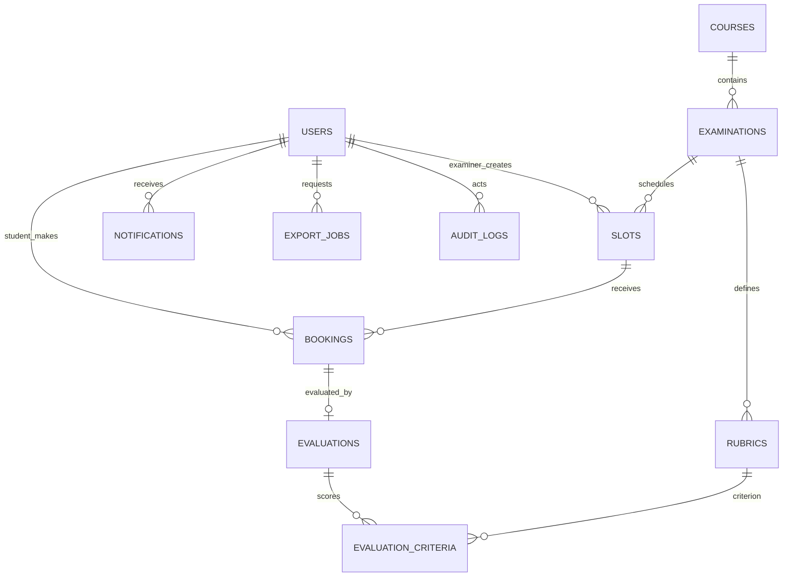

# Database schema

SQLite is initialized programmatically by `backend/database.py`. Foreign keys are enabled on each connection.

Tables: `users`, `courses`, `examinations`, `rubrics`, `slots`, `bookings`, `evaluations`, `evaluation_criteria`, `notifications`, `export_jobs`, `audit_logs`. Historical courses/examinations are deactivated/closed rather than deleted when referenced.
